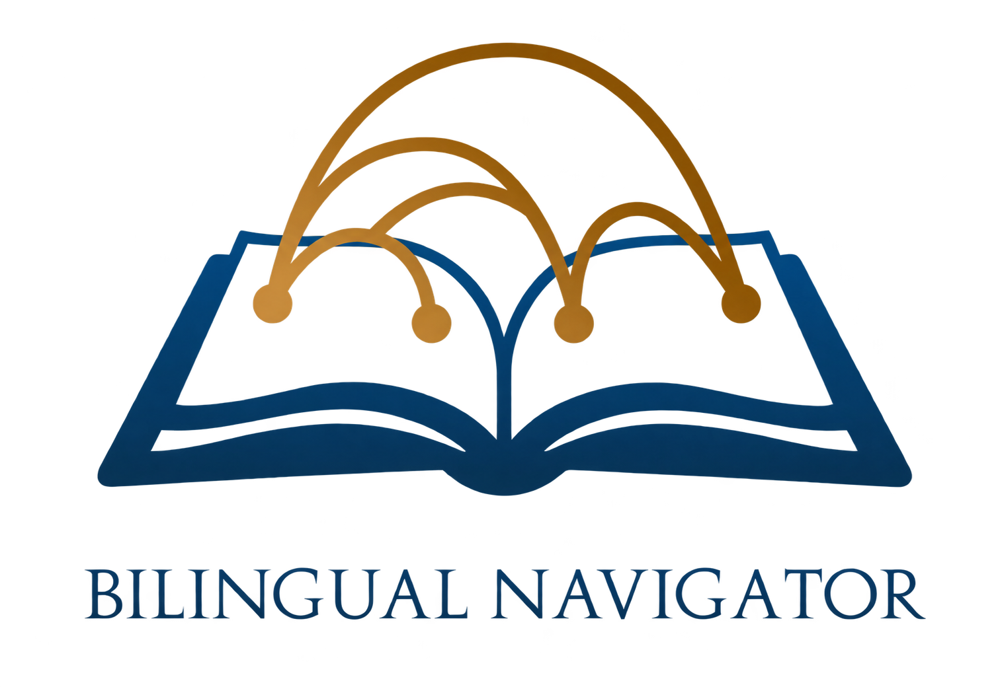
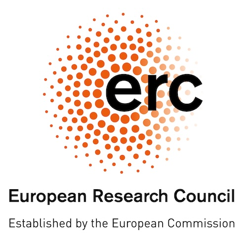

Bilingual New Testament manuscripts, parsed and word-aligned, built with [Hexapla](https://github.com/rbturnbull/hexapla).

**This is a prerelease of the Bilingual Navigator.** The data is subject to change. More manuscripts will be added
soon, along with more content from the manuscripts already included.

The Navigator presents bilingual and multilingual New Testament manuscripts verse by verse, linking words across
languages to help researchers explore translation, grammar and vocabulary. It forms part of BICROSS, ‘The Significance
of Bilingual Manuscripts for Detecting Cross-Language Interaction in the New Testament Tradition’.

## Layout

- `bicross-navigator-config.yaml`: the theme, the manuscripts and the alignments between them.
- `theme/`: logo, Bootstrap variables (`variables.scss`), the about page (`about.md`) and the images it shows
  (`assets/`, such as the ERC logo).
- One folder per codex, holding its TEI transcriptions, CoNLL-U parses (mcparser) and alignment links (mcaligner).

Everything about a manuscript (its language, name, shelfmark, GA/VL/Trismegistos numbers, date, description,
transcribers and licence) is in the TEI header of its transcription. The site licence (CC BY-NC-SA 4.0) covers the
parses and alignments, and any transcription whose TEI header does not give its own licence.

## Building

```bash
pip install hexapla
hexapla validate bicross-navigator-config.yaml
hexapla build bicross-navigator-config.yaml --output site
python -m http.server 8989 --directory site
```

Pushing to `main` builds and publishes the site with GitHub Pages (`.github/workflows/pages.yml`).

## Credits

The BICROSS Navigator and Hexapla were developed by [Robert Turnbull](https://robturnbull.com)
(Melbourne Data Analytics Platform, University of Melbourne).
Transcription contributors and licences are recorded in each manuscript’s TEI header and displayed on its manuscript
page. Parses were made with [MCParser](https://github.com/rbturnbull/mcparser), and word alignments with
[MCAligner](https://github.com/rbturnbull/mcaligner).

<a href="https://github.com/rbturnbull/mcparser"></a>
<a href="https://github.com/rbturnbull/mcaligner"></a>

## Funding

The research leading to this contribution was conducted as part of the BICROSS project (‘The Significance of Bilingual
Manuscripts for Detecting Cross-Language Interaction in the New Testament Tradition’), which has received funding from
the European Research Council (ERC) under the European Union’s Horizon Europe Research and Innovation Programme (Grant
Agreement No. 101043730 – BICROSS – ERC-2021-COG). Funded by the European Union. Views and opinions expressed are
however those of the author only and do not necessarily reflect those of the European Union or the European Education
and Culture Executive Agency (EACEA). Neither the European Union nor EACEA can be held responsible for them.


