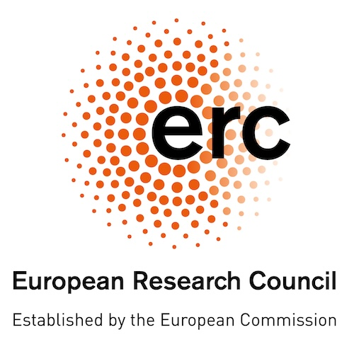

# About the BICROSS Navigator

The BICROSS Navigator presents bilingual and multilingual New Testament manuscripts verse by verse. Both texts of each
manuscript are parsed, and every word is linked to its counterpart in the other language, so you can see how the
translator rendered the grammar and vocabulary of the source text.

## Funding

{width=160 .float-end .ms-4 .mb-3}

The research leading to this contribution was conducted as part of the BICROSS project (‘The Significance of Bilingual
Manuscripts for Detecting Cross-Language Interaction in the New Testament Tradition’), which has received funding from
the European Research Council (ERC) under the European Union’s Horizon Europe Research and Innovation Programme (Grant
Agreement No. 101043730 – BICROSS – ERC-2021-COG). Funded by the European Union. Views and opinions expressed are
however those of the author only and do not necessarily reflect those of the European Union or the European Education
and Culture Executive Agency (EACEA). Neither the European Union nor EACEA can be held responsible for them.

## How the texts were prepared

- **Transcriptions** are TEI XML files, many from the IGNTP, ITSEE and the INTF's NTVMR. Each manuscript page names its
  transcribers and the licence of its transcription.
- **Parses** (lemmas, parts of speech, morphology and syntax) were made with mcparser.
- **Alignments** between the two texts were made with mcaligner and checked by hand.

The site is built with [Hexapla](https://github.com/rbturnbull/hexapla).
